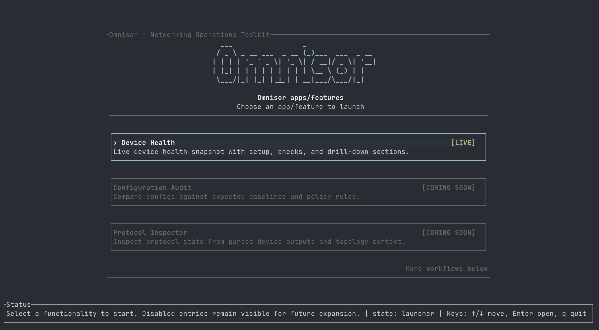

<p align="center">
    
</p>

<h1 align="center">Omnisor</h1>
<p align="center">Network-device SSH library/crate & Terminal UI App</p>

## What Omnisor Is

Omnisor is a Rust workspace for working with network devices in two ways:

- as a library through `omnisor`, with vendor-aware SSH and interactive device-session APIs
- as a terminal ui app through `omnisor-app`, with troubleshooting workflows built on top of the same core primitives

Today, the app is real and usable, with Device Health as the first implemented app/feature. The repo is structured so the core SSH/device logic, reusable troubleshooting logic, and terminal UX can evolve together without being collapsed into one crate.

> [!WARNING]
> Omnisor is still evolving. APIs, app workflows, and package boundaries may continue to change while the project matures.

## Quick Start

### Library Quick Start

Add `omnisor` and `tokio`:

```bash
cargo add omnisor
cargo add tokio
```

Then connect to a device and execute commands:

```rust
use omnisor::{CiscoVariant, DeviceSession};

#[tokio::main]
async fn main() -> Result<(), omnisor::Error> {
    let mut session = DeviceSession::connect(
        ("192.168.1.1", 22),
        "admin",
        "password",
        CiscoVariant::Ios,
    )
    .await?;

    let result = session.send_command("show version").await?;
    println!("{}", result.output);

    session.close().await?;
    Ok(())
}
```

For more library examples and device-session details, see [`crates/omnisor/README.md`](crates/omnisor/README.md).

### App Quick Start

Run the terminal app from the workspace root:

```bash
cargo run -p omnisor-app
```

The app opens into the Omnisor launcher and currently includes the Device Health workflow. That flow owns its own connection setup and can validate a device session before collecting a health snapshot.

For app-specific notes, see [`apps/omnisor-app/README.md`](apps/omnisor-app/README.md).

## Workspace Overview

Omnisor is organized as a workspace with a small set of focused packages:

- [`crates/omnisor/README.md`](crates/omnisor/README.md): the core async SSH and network-device session library
- [`crates/omnisor-health/README.md`](crates/omnisor-health/README.md): reusable health and troubleshooting domain logic
- [`crates/omnisor-feature-device-health/README.md`](crates/omnisor-feature-device-health/README.md): the Device Health feature flow used by the app
- [`apps/omnisor-app/README.md`](apps/omnisor-app/README.md): the ratatui terminal application and launcher shell

## Current Capabilities

- Vendor-aware SSH/device sessions for network devices through the `omnisor` crate
- Built-in support for supported vendor/model profiles such as Cisco and Juniper variants
- Interactive command execution and mode transitions for network-device operations
- Reusable health/troubleshooting logic that can be consumed outside the UI
- A ratatui terminal app with a launcher and Device Health as the current live workflow

## Library Example

For slightly more control over the connection, use the builder API:

```rust
use omnisor::{CiscoVariant, DeviceSession};

#[tokio::main]
async fn main() -> Result<(), omnisor::Error> {
    let mut session = DeviceSession::builder()
        .address("192.168.1.1")
        .port(22)
        .username("admin")
        .password("password")
        .vendor(CiscoVariant::IosLegacy)
        .connect()
        .await?;

    let result = session.send_command("show ip interface brief").await?;
    println!("{}", result.output);

    session.close().await?;
    Ok(())
}
```

Deeper examples, legacy-device notes, custom SSH algorithm configuration, and mode-handling examples live in [`crates/omnisor/README.md`](crates/omnisor/README.md).

## App Today

`omnisor-app` is the terminal-UI entrypoint for operator workflows.

- It starts at a launcher rather than dropping directly into a single task.
- Device Health is the currently implemented workflow.
- The app is designed to expand into more troubleshooting and network-operations flows over time.

The app is built on the core `omnisor` device APIs and the reusable `omnisor-health` domain layer, so the same underlying capabilities can be used programmatically or through the UI.

## Status

Omnisor is in active development.

- The core library is usable today for device-session work.
- The terminal app exists today and is growing workflow by workflow.
- Supported vendors, models, and troubleshooting features are expanding incrementally rather than all at once.

## Contributing

Contributions are welcome across the library, app, docs, and overall workspace structure.

If you want to help, open an issue, propose a change, or submit a PR with improvements to code, documentation, UX, or examples.
