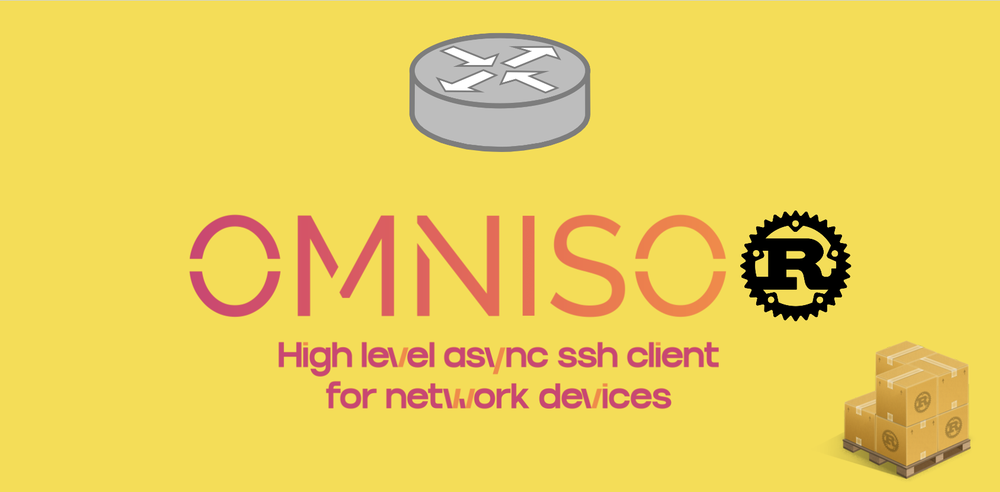

<!-- <p align="center">
    
</p>

<h1 align="center">Omnisor — Network Troubleshooting Workbench</h1>

# About

Omnisor is a standalone network troubleshooting workbench for an engineer's laptop,
built in Rust with a native GPUI interface. One repository contains the desktop
application, shared engine libraries, optional collection adapters, and labs.

The desktop starts idle with a dark workspace and compact mini-app sidebar.
Device Health asks for device access and resolves the collection method internally,
then runs a managed SNMP exporter
when needed and an OpenTelemetry Collector. Local OTLP feeds CPU/memory/traffic
history, device details, interface state, and findings. Direct Prometheus endpoints
and a clearly labeled synthetic pipeline use the same receiver and UI.

Profiles and versioned YAML assets live under [collection/](collection/README.md).
Recorded captures remain available without collection. Persistent investigations,
broader validated device coverage, and release installers remain future work.

```sh
cargo run -p omnisor-desktop --features gui
```

See the [desktop guide](apps/omnisor-desktop/README.md) for native build prerequisites
and capture-file options. No server, account, or internet connection is required
to inspect the bundled capture after building.

## Workspace packages

- `apps/omnisor-desktop`: primary GPUI workbench and GUI-independent workspace model
- `crates/omnisor`: asynchronous SSH/device library and verified sessions
- `crates/omnisor-health`: reusable health checks and findings
- `crates/omnisor-telemetry`: OTLP normalization, metric profiles, and initial rules
- `crates/omnisor-collection`: local Collector/exporter supervision, ingestion, history and rates
- `collection`: shared pipeline assets, versioned exporter modules, vendor/OS/model profiles
- `examples/telemetry`: real Prometheus/OTel pipeline examples and captured evidence
- `tools/omnisor-lab`: synthetic device lab

The existing ratatui application (`apps/omnisor-app`) and its Device Health feature
remain development clients. The primary product workstream is the GPUI desktop.

> [!WARNING]
> Omnisor is under development. A source profile, synthetic fixture, and validated
> device/OS combination represent different levels of support.

## Collection and troubleshooting

The collection direction is adapter-based: Prometheus exporters, OpenTelemetry,
gNMI/OpenConfig, and structured APIs where available, with explicit SSH diagnostics
and fallback. The local runtime manages Collector/exporter processes and feeds shared
observations and bounded history into the desktop after an explicit Start action.

The existing SSH health collector covers Cisco IOS, IOS-XE, and IOS Legacy command
formats. Other core SSH profiles do not imply health coverage. The
[telemetry walkthrough](examples/telemetry/README.md) demonstrates actual Prometheus
scraping and OTLP delivery, profile-based normalization, and an inspectable local
example independent of the desktop shell.

## Product direction and roadmap

The [desktop roadmap](ROADMAP.md) and [architecture](docs/product/ARCHITECTURE.md)
define the current direction: modular local functionality, shared Rust libraries,
local investigation records, explicit collection status, and bounded laptop resource
usage. The [compatibility register](docs/product/COMPATIBILITY.md) records validation.
Prior web/team commercial and pilot proposals are labeled historical.

## Run and test the workspace

```sh
cargo run -p omnisor-desktop --features gui
cargo test --workspace
cargo fmt --all --check
cargo clippy --workspace --all-targets -- -D warnings
cargo clippy -p omnisor-desktop --features gui --all-targets -- -D warnings
```

Default tests use local validation and synthetic device output; no GNS3 or SSH server
is needed. Rust dependencies must be downloaded before Cargo can run offline.
Live SSH/service tests are opt-in through the core crate's `ssh-integration-tests`
feature. The Docker and local scripts in `tests/` activate that feature and require
their configured services; see the [core testing guide](crates/omnisor/README.md#testing).

For local network devices, use the [device lab](tests/lab/README.md):

```sh
./tests/lab.sh start        # Nine synthetic Cisco/Juniper SSH endpoints
./tests/lab.sh test         # Isolated device/session/health integration tests
./tests/lab.sh real start   # Shared GNS3/QEMU backend for real OS images
```

The real-image backend supports software CPU emulation on Apple Silicon;
vendor images and their compatibility must be validated separately. The lab
guide includes official image sources and the current platform limitations.


## Install

For the library crate, use `omnisor`.

Add Omnisor and Tokio to your Cargo.toml:

```toml
[dependencies]
tokio = "1"
omnisor = "0.1.3"
```

Or manually add both of them through cargo 
```bash
cargo add omnisor
cargo add tokio
```

## Usage

### Quick Start - Standard SSH

For simple command execution on Linux/Unix servers, you can either use omnisor or async-ssh2-tokio.

### Quick Start - Network Devices

For interactive sessions with network devices (routers, switches, firewalls):

```rust
use omnisor::{DeviceSession, CiscoVariant};

#[tokio::main]
async fn main() -> Result<(), omnisor::Error> {
    let mut session = DeviceSession::connect(
        ("192.168.1.1", 22),
        "admin",
        "password",
        CiscoVariant::Ios,
    ).await?;

    let result = session.send_command("show version").await?;
    println!("{}", result.output);

    let result = session.send_command("show ip route").await?;
    println!("{}", result.output);

    session.close().await?;
    Ok(())
}
```

### Device Session Builder

For more control over device connections:

```rust
use omnisor::{CiscoVariant, DeviceSession};

#[tokio::main]
async fn main() -> Result<(), omnisor::Error> {
    let mut session = DeviceSession::builder()
        .address("192.168.1.1")
        .port(22)
        .username("admin")
        .password("password")
        .vendor(CiscoVariant::IosLegacy)
        .connect()
        .await?;

    let result = session.send_command("show version").await?;
    println!("{}", result.output);

    session.close().await?;
    Ok(())
}
```

### Legacy Device Support

For older devices requiring legacy SSH algorithms (for example older Cisco IOS):

```rust
use omnisor::{DeviceSession, CiscoVariant};

#[tokio::main]
async fn main() -> Result<(), omnisor::Error> {
    // Use IosLegacy variant for older Cisco devices
    let mut session = DeviceSession::connect(
        ("192.168.1.1", 22),
        "admin",
        "password",
        CiscoVariant::IosLegacy,
    ).await?;

    let result = session.send_command("show version").await?;
    println!("{}", result.output);

    session.close().await?;
    Ok(())
}
```

### Custom SSH Algorithms

For control over SSH algorithms you can specify whatever you like that is supported under https://github.com/Eugeny/russh

```rust
use omnisor::{DeviceSession, CiscoVariant, SshAlgorithms, kex, cipher, mac};

#[tokio::main]
async fn main() -> Result<(), omnisor::Error> {
    let mut session = DeviceSession::builder()
        .address("192.168.1.1")
        .username("admin")
        .password("password")
        .vendor(CiscoVariant::Ios)
        .ssh_algorithms(
            SshAlgorithms::new()
                .kex(vec![kex::DH_G14_SHA1, kex::DH_G1_SHA1])
                .cipher(vec![cipher::AES_256_CBC, cipher::AES_128_CBC])
                .mac(vec![mac::HMAC_SHA1])
        )
        .connect()
        .await?;

    let result = session.send_command("show version").await?;
    println!("{}", result.output);

    session.close().await?;
    Ok(())
}
```

### Enable and Config Mode Support


Omnisor offers ready to use methods to change between router modes (user/enable/config)
> [!IMPORTANT]
> **Don't expect complete support for every device vendor and version as of now. This has been massively influenced by cisco devices.**

```rust
use omnisor::{CiscoVariant, DeviceSession};

#[tokio::main]
async fn main() -> Result<(), omnisor::Error> {
    let mut session = DeviceSession::connect(
        ("192.168.142.130", 22),
        "cisco",
        "cisco",
        CiscoVariant::IosLegacy,
    )
    .await?;

    //Be careful with the chronology of steps for now.
    //In the future I plan to offer the possibility
    //of going into any mode from every other mode
    //without having to follow the normal chronology of steps.
    let _ = session.enter_enable_mode("enable", Some("cisco")).await?;
    let _ = session.enter_config_mode("config t").await?;
    let _ = session.exit_config_mode("exit").await?;
    let _ = session.exit_from_enable_mode("disable").await?;

    session.close().await?;
    Ok(())
}
```

# Contribution

To contribute to this project all you need is to enjoy working on open source projects and absolutely nothing else. Also be respectful!
So... fork the repo, fix bugs, potentially optimize, improve docs. Whatever you think this project needs and all will be carefully reviewed/considered -->
