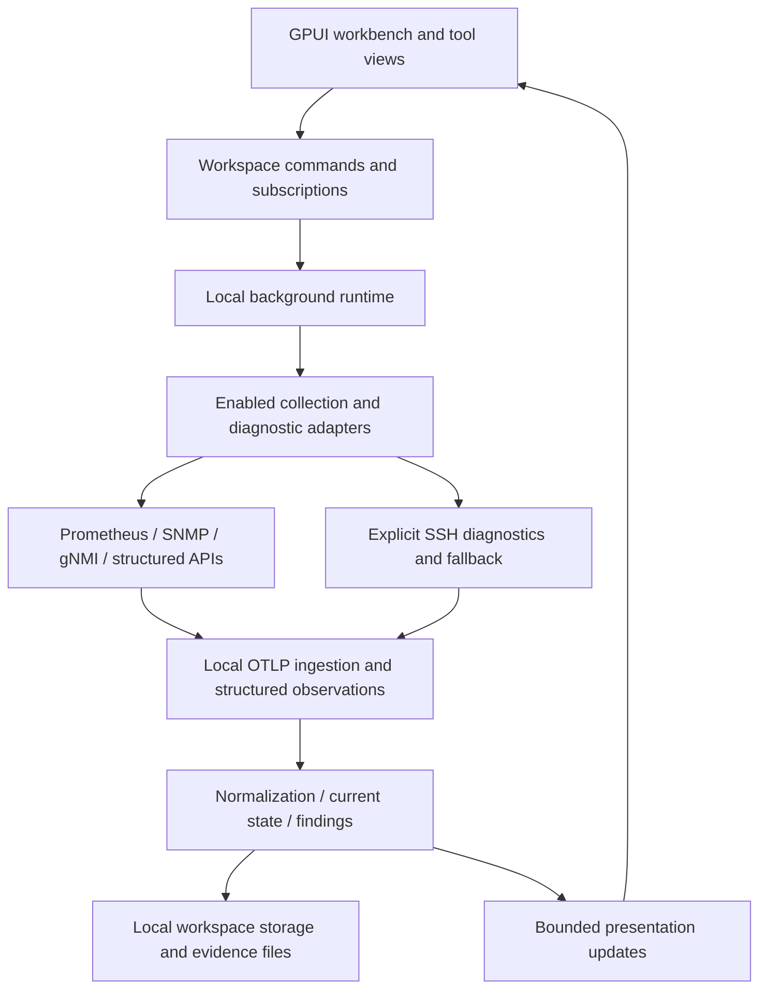

# Standalone desktop architecture

Direction updated 2026-11-13: Omnisor is one standalone network troubleshooting
application in one Rust workspace. GPUI is the only application interface on the engineer's
laptop. The application owns local collection and investigation state; normal use
does not require SaaS accounts, a web server, message brokers, or external databases.

## Current implementation

`app` provides the GPUI workbench and a GUI-independent workspace
model. It starts with a compact persistent mini-app sidebar and a Device Health
start view, without loading data or starting collection. The sidebar is generated
from the registry and scrolls as tools are added; health subviews use a separate tab row.
Selecting Device Health opens device setup. The engineer selects a saved device
or supplies an address, device family and required access credentials. Internal
profile/site policy selects the protocol, exporter, cadence and mappings; these
are not connection-form choices. Explicit Connect creates a local
`collection` session: optional SNMP exporter, Collector, authenticated OTLP
receiver, normalization, bounded history/rates, and immutable desktop snapshots.
Direct Prometheus and synthetic paths use the same ingestion architecture. The
live overview graphs CPU, memory and traffic, with device identity provenance and
freshness-aware summaries. Capture-file import is currently unavailable.

This first runtime supports one active desktop device session. Persistent local
workspaces, component pooling, binary distribution, model discovery and broader
hardware validation remain future work. See [collection design](../../collection/README.md)
for implemented configuration layout, statistical semantics, limits and validation.

SSH connectivity, health checks, telemetry processing, and synthetic labs remain
reusable Rust libraries and development tools independent of the GPUI application.

## Mini apps and capability ownership

The launcher registers independent mini-apps with availability and declared
capabilities. Device Health is the first implemented entry; its interface and
observation views are internal health subviews, not separate top-level mini-apps.
Configuration comparison and IP utilities have no metric dependency. Protocol
inspection can need device access without implying a metrics pipeline.

Opening a tool selects its UI only and starts no collectors.
Only an explicit live operation can request capabilities from the runtime.
The runtime must acquire the required components for that operation, and release
its ownership on stop/exit; unrelated tools must not start a global collection stack.
Shared components should stop only after their final active owner releases them.
Navigation generations reject late asynchronous results after closing a mini-app.

## Layers and dependency direction

The desktop model and domain libraries must compile and run tests without GPUI or
a display server. GPUI owns rendering and interaction. It sends commands to the
runtime and receives coalesced updates; networking, subprocesses, file imports,
database work, and long-running diagnostics stay outside render methods.

The application is a modular local program, not a collection of microservices.
Modules communicate through Rust interfaces and bounded channels. We introduce
an out-of-process boundary only for existing collectors/exporters or a measured
need for isolation. Runtime implementation must explicitly bridge Tokio work and
GPUI's foreground executor; GPUI tasks cannot assume a Tokio runtime is present.

## Repository layout

| Location | Responsibility |
| --- | --- |
| `app` | GPUI shell, workspace state, tool routing, presentation |
| `crates/ssh` | SSH transport, device sessions, trust policies |
| `crates/health` | Existing health checks, status and findings |
| `crates/telemetry` | OTLP types, profile mappings, canonical observations, initial rules |
| `crates/collection` | Typed plans/profiles, process supervision, local OTLP, bounded history/rates, snapshots |
| `collection` | Shared Collector config, pinned generated exporter modules, vendor/OS/model profiles |
| Future local storage crate | Inventory, investigations, observations, migrations, retention |
| `examples/telemetry` | Runnable collector configs, profiles, captured sample evidence |
| `tools` and `tests/lab` | Synthetic sources, replay tests, compatibility and performance labs |

New capabilities should extend these boundaries or add a focused crate when needed.
Do not create a repository, executable, or process for every feature. Inventory,
health, interfaces, neighbors/topology, protocols, configuration comparison, and
diagnostics share device identity and workspace records.

## Collection adapters and device profiles

An adapter owns a collection mechanism; a profile describes the supported device
schema. Profiles record vendor/model/OS constraints, metric/path/OID mappings,
units, measurement windows, entity identity, and validation evidence.

Select sources per capability rather than assigning one source to an entire
device. Prefer structured access. Use CLI collection for explicit diagnostic needs
or gaps in supported interfaces. A source that cannot collect a check reports that
gap; it never manufactures a healthy zero or silently triggers another protocol.

| Adapter | Local implementation direction |
| --- | --- |
| Native Prometheus endpoint | Collector Prometheus receiver |
| SNMP | Existing SNMP exporter plus Collector scraping |
| gNMI/OpenConfig | Existing collector such as gNMIc, supplying OTLP and structured state |
| NETCONF/RESTCONF/vendor API | Structured adapter with explicit model support |
| Events | Syslog, notifications, on-change subscriptions |
| SSH | Verified device sessions for on-demand diagnostics and fallback |

Adapter enablement is an internal policy/capability concern. Engineers select the
functionality and device; the runtime resolves the collection method. Disabled
modules stop their work and explain missing coverage. Device/OS compatibility is separately recorded
in the [compatibility register](COMPATIBILITY.md).

## Local process lifecycle

The current session supervisor owns an optional exporter, Collector, receiver,
private temporary configuration, bounded/redacted diagnostics and cleanup. It
uses a dedicated Tokio runtime outside GPUI and publishes immutable snapshots.
Normal Stop and app closure reap children and remove session credentials. Failed
children stop the session; automatic restart and pooled dependencies are future work.

The broader lifecycle remains:

1. Resolve device/model and site access policies into a collection plan; validate
   only the inputs and credential requirements of that plan.
2. Start authenticated loopback ingestion and determine its bound address.
3. Generate restricted-access configuration for required components.
4. Start exporters, check readiness, and then start the Collector.
5. Confirm collection through received observations and scrape outcomes; process
   readiness alone does not establish device reachability.
6. Apply configuration changes with validation and controlled restart/reload.
7. On stop, stop acquisition, drain/persist pending work within a deadline, and
   close ingestion last. Terminate and reap remaining owned children.

Use shared collectors/exporters across device targets with bounded concurrency.
Distribute schedules to avoid polling bursts and protect device management planes.
Restart only affected components with backoff. Window closure stops owned collection
by default. An explicit background-service mode is a separate future decision.

Distribute pinned, verified platform binaries or allow explicit paths to installed
tools. The desktop app must report missing components and configuration errors.
It must not silently install or download executable tools when opening a workspace.

## Observations and storage

Preserve measurement kind, units, averaging windows, timestamps, source/profile
revision, and stable device/entity identity. Separate measurements, inventory/state,
relationships, events, and diagnostic evidence. OTLP handles measurements and
appropriate event records; rich relationships and large evidence need typed models.

Freshness is per capability/entity. Partial, unsupported, unavailable, and stale
states remain visible. Historical captures are never presented as current readings.
Empty findings do not resolve previous incidents. Record deletions and observation
scope so missing neighbor/protocol entries do not imply recovery.

Start persistent workspaces with SQLite and a local evidence directory. Add schema
migrations, retention, bounded measurement history, backup/export, and interrupted
session recovery with that implementation. The current desktop retains bounded session history in RAM and implements no
persistent workspace storage. Evaluate alternate storage only after workload
benchmarks demonstrate a need; do not require a server database on the laptop.

## Performance and failure isolation

- Bound connections, active jobs, subscriptions, memory queues, disk buffers, and
  retained data. Cancel work when its investigation stops.
- Batch ingestion and writes. Use cached profile/inventory context instead of
  querying storage per sample.
- Coalesce UI updates, downsample charts, virtualize large lists, and load evidence
  on demand. Display refresh is independent of collection frequency.
- Exercise reconnect bursts, slow sources, malformed telemetry, component crashes,
  interrupted jobs, full buffers, and delayed storage.
- Measure end-to-end freshness, CPU/RSS, UI responsiveness, query latency, device
  load, and disk growth on representative laptops. No unlimited-fleet claim follows
  from modularity; document the tested workload envelope.

## Trust and privacy

The current session takes credentials from masked form inputs and uses private
temporary exporter configuration; normal cleanup removes it after process reaping.
Persistent credential storage is not implemented. A future workspace should use
the OS credential store and retain references rather than plaintext passwords.
Verify SSH host keys and TLS certificates; label explicit lab-only exceptions.
Protect loopback APIs with scoped credentials and appropriate origin/host checks.
Exclude credentials from generated command arguments, logs, evidence, and exports.

Local investigation data stays local unless the user explicitly exports it or
configures an integration. Updates, optional diagnostics reporting, and future
integrations must not be prerequisites for an offline investigation.
